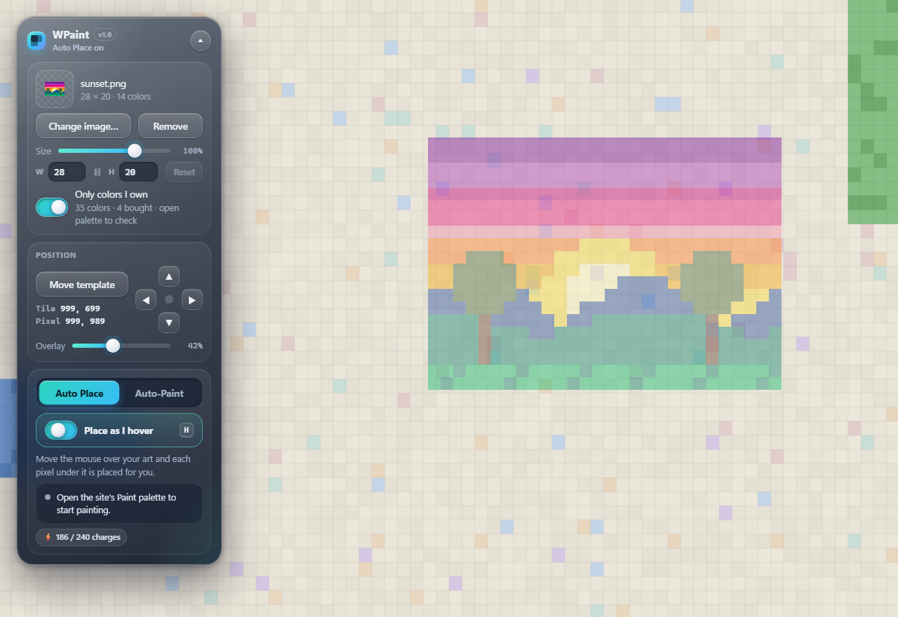
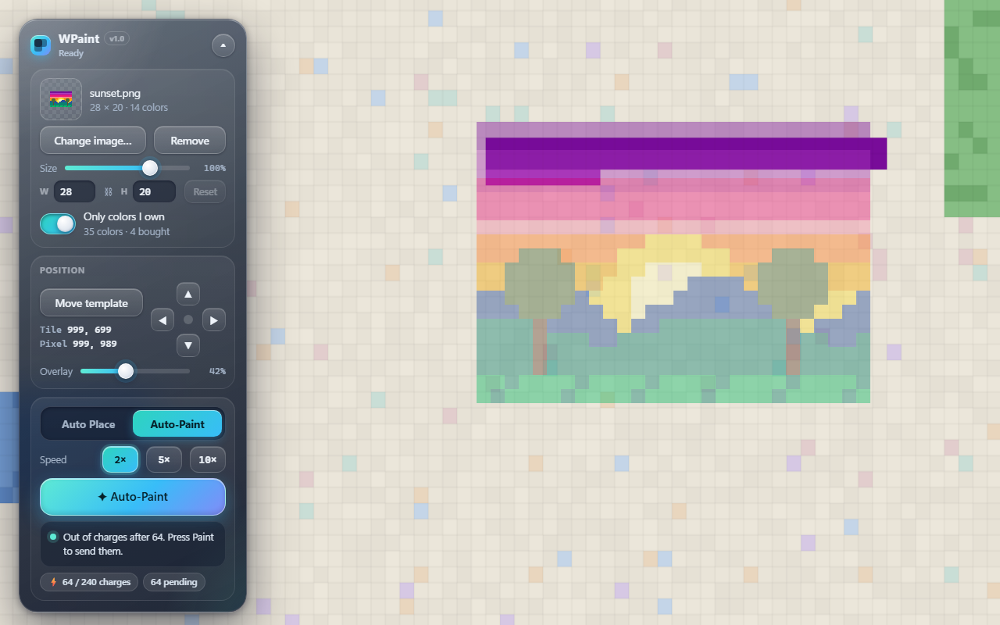

<p align="center">
  
</p>

<p align="center">
  
  
  
  
</p>

<p align="center">
  <b>WPaint</b> puts your artwork over the <a href="https://wplace.live">WPlace</a> map and places the right color<br>
  as you move the mouse over each pixel, so you don't have to click hundreds of times.
</p>

---

> [!NOTE]
> WPaint was made for people who love WPlace but find constant clicking painful (arthritis, carpal tunnel, RSI).
> It never sends anything on its own. Pixels only go out when **you** press the site's own **Paint** button.

## ✨ Features

| Feature | What it does |
|---|---|
| 🖱️ **Auto Place** | Turn it on, open the Paint palette, and glide the mouse over your art. Each pixel under the cursor gets the right color and is placed for you. |
| 🤖 **Auto-Paint** | Give your hand a break. A ghost cursor fills in the pixels on screen for you, stopping when your charges run out. |
| ⏩ **Speed buttons** | Run Auto-Paint at normal speed, or <kbd>2×</kbd> <kbd>5×</kbd> <kbd>10×</kbd>. Click the lit one again to go back to normal. |
| 🔀 **Mode switcher** | Auto Place and Auto-Paint each have their own tab and keep their own settings. |
| 📐 **Live resize** | Drag the size slider or type a width or height. The ratio stays locked and the preview updates as you go. |
| 🎨 **Colors you own** | Reads which premium colors your account has bought, so the art only uses colors you can actually place. |
| ✅ **Skips finished pixels** | Checks the live canvas and only places pixels that don't already match. |
| 🧭 **Easy positioning** | Click once to drop the template, then nudge it pixel by pixel with the arrow pad. Overlay opacity is adjustable. |
| 💾 **Remembers everything** | Your image, position, size and settings are still there after you close the browser, until you press **Remove**. |
| 🪟 **Slate glass panel** | A small, draggable panel that collapses out of the way when you don't need it. |

## 📸 Screenshots

<table>
  <tr>
    <th>Auto Place</th>
    <th>Auto-Paint</th>
  </tr>
  <tr>
    <td align="center" valign="top"></td>
    <td align="center" valign="top"></td>
  </tr>
</table>

<p align="center">
  
  <br><sub><i>Auto-Paint at work. The ghost cursor fills in the purple sky one pixel at a time.</i></sub>
</p>

<details>
<summary><b>More screenshots</b></summary>
<br>
<p align="center">
  
  <br><sub><i>The template sits over the map, ready for Auto Place.</i></sub>
</p>
<p align="center">
  
  <br><sub><i>Auto-Paint stops when your charges run out. Press Paint to send them.</i></sub>
</p>
</details>

> [!TIP]
> The screenshots use a made-up demo map, not real WPlace art.

## 📦 Install

WPaint isn't on the Chrome Web Store, so you load it yourself. It takes about a minute.

1. Download this repo: **Code ▸ Download ZIP**, then unzip it somewhere you'll keep it.
2. Open <code>chrome://extensions</code> (or <code>edge://extensions</code> in Edge).
3. Turn on **Developer mode** (top right in Chrome, left sidebar in Edge).
4. Click **Load unpacked** and pick the unzipped folder (the one that has `manifest.json` in it).
5. Open or reload [wplace.live](https://wplace.live). The WPaint panel appears on the left side. Drag its header to move it.

> [!IMPORTANT]
> Don't delete or move the folder after loading it. The browser runs WPaint from that folder.
> To update, replace the files and press the ↻ reload button on the extension card.

## 🎨 How to use

### 1. Add your art
- Click **Choose image…** and pick a PNG or JPG.
- Use the **Size** slider (or the **W** / **H** boxes) to make it the size you want. **Reset** goes back to the image's own size.
- Leave **Only colors I own** on so the art only uses colors your account can place.

### 2. Put it on the map
- Click **Move template**, then click the map where the **top-left corner** should go.
- Fine-tune with the ▲ ◀ ▶ ▼ pad. Each press moves it one pixel.
- Use the **Overlay** slider to make the template more or less see-through.

### 3. Paint
Open the site's **Paint** palette first, then pick a mode:

<table>
<tr>
<td width="50%" valign="top">

#### 🖱️ Auto Place
1. Choose the **Auto Place** tab.
2. Turn on **Place as I hover** (or press <kbd>H</kbd>).
3. Move the mouse over your art. No clicking.
4. Press the site's **Paint** button to send the pixels.

</td>
<td width="50%" valign="top">

#### 🤖 Auto-Paint
1. Choose the **Auto-Paint** tab.
2. Pick a speed if you like: <kbd>2×</kbd> <kbd>5×</kbd> <kbd>10×</kbd>.
3. Press **✦ Auto-Paint** and let it work.
4. When it says it's done, press the site's **Paint** button.

</td>
</tr>
</table>

> [!TIP]
> Auto-Paint only fills pixels that are **on screen**. Zoom out or pan so your art is in view.
> It also stops at your charge count, so it never queues more than you can send.

### ⌨️ Shortcuts

| Key | What it does |
|:---:|---|
| <kbd>H</kbd> | Turns Auto Place on or off (and switches to the Auto Place tab) |
| <kbd>Esc</kbd> | Stops Auto-Paint, or cancels moving the template |

## 🔒 Privacy & safety

> [!IMPORTANT]
> - 🚫 **No passwords, tokens or cookies are stored or sent anywhere** by WPaint.
> - 👤 To see your charges and bought colors, it reads the same account info the site itself loads (`/me`), using the site's own login.
> - 💾 Your template and settings are saved only in your browser's local storage for wplace.live.
> - ✋ Nothing is painted until **you** press the site's **Paint** button, so the site's normal checks happen exactly as usual.
> - 🧩 It only runs on `https://wplace.live/*` and asks for no extra browser permissions.

## 🛠️ Troubleshooting

<details>
<summary><b>The panel says “Move or zoom the map once to connect.”</b></summary>
<br>
Drag or scroll the map a little. WPaint hooks into the map the first time it moves.
</details>

<details>
<summary><b>Nothing gets placed when I hover.</b></summary>
<br>

- Make sure the site's **Paint** palette is open.
- Make sure **Place as I hover** is on (the status dot turns green).
- Pixels that already match your art are skipped on purpose.
</details>

<details>
<summary><b>Some colors are skipped as “locked”.</b></summary>
<br>
Those are premium colors you haven't bought. Turn on <b>Only colors I own</b> and WPaint will pick the closest color you do have.
</details>

<details>
<summary><b>“Could not find the WPlace map.”</b></summary>
<br>
The site may have updated. Reload the page. If it keeps happening, please open an issue.
</details>

<details>
<summary><b>My image is too big to save.</b></summary>
<br>
Very large images can't fit in browser storage. WPaint still works until you reload. Try a smaller image or shrink it first.
</details>

## 📁 What's inside

```
├── manifest.json     extension settings (Manifest V3)
├── hover-paint.js    all of WPaint: map hook, template, panel, Auto Place and Auto-Paint
├── icons/            app icon (SVG source and PNG sizes)
└── docs/             README images
```

## ⚠️ Disclaimer

> [!WARNING]
> WPaint is a fan-made helper and is **not affiliated with or endorsed by WPlace**.
> Please follow the site's rules and be kind to other people's art. Use it at your own risk.

<p align="center"><sub>Made with 💙 for comfy pixel painting.</sub></p>
