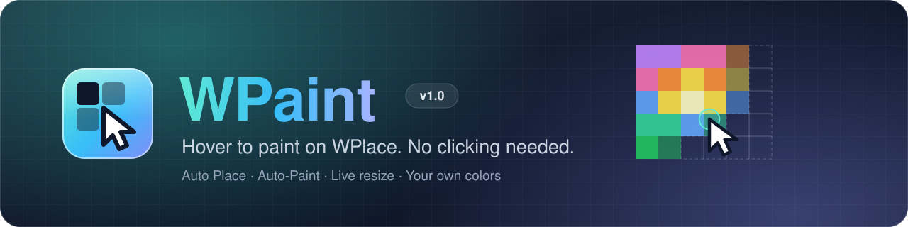
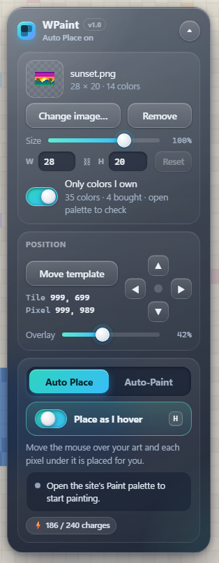
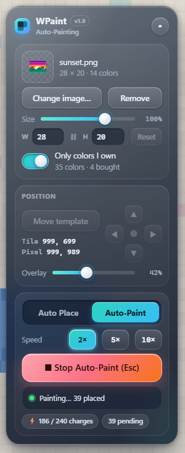
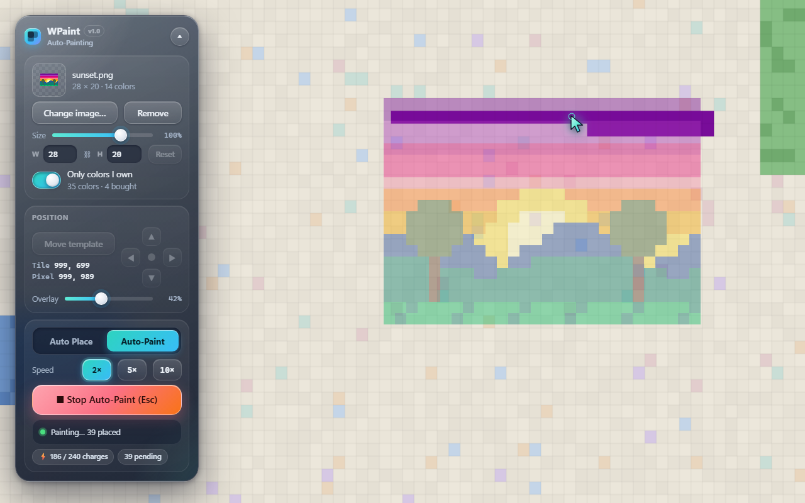

<p align="center">
  
</p>

<p align="center">
  
  
  
  
  
  <a href="LICENSE"></a>
</p>

<p align="center">
  <a href="https://github.com/Kadoodly/wpaint/releases/latest"></a>
</p>

<p align="center">
  A browser extension that overlays a template image on the <a href="https://wplace.live">WPlace</a> canvas<br>
  and selects and places the matching color as the cursor moves over each pixel.
</p>

<p align="center">
  <a href="https://kadoodly.github.io/wpaint/"><b>Website</b></a>
  &nbsp;·&nbsp;
  <a href="https://github.com/Kadoodly/wpaint/releases/latest"><b>Download</b></a>
  &nbsp;·&nbsp;
  <a href="https://github.com/Kadoodly/wpaint/issues"><b>Report an issue</b></a>
</p>

> [!WARNING]
> **Use at your own risk.** WPaint is an independent project and is not affiliated with, endorsed by, or supported by WPlace.
> Automated or assisted input may conflict with the site's terms of service, and your account is your responsibility.
> The software is provided as-is, without warranty of any kind.

> [!NOTE]
> **AI-generated project.** WPaint was created entirely with AI, including its source code, documentation, icon and screenshots.
> See [AI disclosure](#ai-disclosure) for details.

## Contents

- [Overview](#overview)
- [Features](#features)
- [Screenshots](#screenshots)
- [Installation](#installation)
- [Usage](#usage)
- [Keyboard shortcuts](#keyboard-shortcuts)
- [Privacy](#privacy)
- [Troubleshooting](#troubleshooting)
- [Project structure](#project-structure)
- [AI disclosure](#ai-disclosure)
- [Disclaimer](#disclaimer)
- [License](#license)

## Overview

WPaint is a free, open-source browser extension for Google Chrome and Microsoft Edge that adds a template overlay and auto painter to [WPlace](https://wplace.live), the collaborative pixel-art world map. It converts any PNG or JPEG into the WPlace color palette, shows it on the map as a guide, and places the correct colors for you.

WPaint takes the repetitive clicking out of painting on WPlace. Load an image, position it on the canvas, and let WPaint pick and place the right color for each pixel. It works alongside the site's normal painting flow: pixels are staged in the site's own palette, and nothing is submitted until you press the site's **Paint** button.

## Features

| Feature | Description |
|---|---|
| **Auto Place** | With the site's Paint palette open, each template pixel under the cursor is given the correct color and placed. No clicking is required. |
| **Auto-Paint** | Fills the template pixels currently on screen using an on-screen cursor, and stops when your available charges are used. |
| **Speed control** | Auto-Paint runs at standard speed or at 2×, 5× or 10×. Selecting the active speed again returns to standard. |
| **Separate modes** | Auto Place and Auto-Paint have their own tabs and keep their own settings. |
| **Live resizing** | Resize the template with a slider or exact width and height values. The aspect ratio is preserved and the preview updates immediately. |
| **Owned colors** | Detects which premium colors your account has unlocked, and limits the template to colors you can place. |
| **Canvas awareness** | Reads the current canvas and skips pixels that already match the template. |
| **Positioning** | Place the template with a single click, adjust it one pixel at a time, and set the overlay opacity. |
| **Persistence** | The image, position, size and settings are saved in the browser and restored on your next visit, until removed. |
| **Compact panel** | A draggable, collapsible control panel. |
| **Standalone** | Runs as a regular browser extension. No Tampermonkey or other userscript manager is needed. |

## Screenshots

<table>
  <tr>
    <th width="50%">Auto Place</th>
    <th width="50%">Auto-Paint</th>
  </tr>
  <tr>
    <td align="center" valign="top"></td>
    <td align="center" valign="top"></td>
  </tr>
</table>

<p align="center">
  
  <br><sub>Auto-Paint in progress. The on-screen cursor fills the template row by row.</sub>
</p>

<sub>Screenshots were taken on a simulated demo canvas and do not show real WPlace artwork.</sub>

## Installation

WPaint is not published on the Chrome Web Store and is installed as an unpacked extension.
It is a standalone extension: **no Tampermonkey, Violentmonkey or other userscript manager is required**.

1. Download `wpaint-1.0.zip` from the [latest release](https://github.com/Kadoodly/wpaint/releases/latest) and extract it to a permanent location.
2. Open `chrome://extensions` in Chrome, or `edge://extensions` in Edge.
3. Enable **Developer mode**.
4. Select **Load unpacked** and choose the extracted `wpaint` folder (the folder containing `manifest.json`).
5. Open or reload [wplace.live](https://wplace.live). The WPaint panel appears on the left side of the page and can be moved by dragging its header.

> [!NOTE]
> The browser loads the extension from the selected folder, so the folder must not be moved or deleted.
> To update, replace the files and select **Reload** on the extension's card.

## Usage

### 1. Load a template

- Select **Choose image…** and open a PNG or JPEG file.
- Adjust the size with the **Size** slider or the **W** and **H** fields. **Reset** restores the original dimensions.
- Keep **Only colors I own** enabled to restrict the template to colors available on your account.

### 2. Position the template

- Select **Move template**, then click the canvas where the template's top-left corner should be.
- Use the arrow pad to adjust the position by one pixel at a time.
- Use the **Overlay** slider to change the template's opacity.

### 3. Paint

Open the site's **Paint** palette, then choose a mode.

<table>
<tr>
<td width="50%" valign="top">

**Auto Place**

1. Select the **Auto Place** tab.
2. Enable **Place as I hover**, or press <kbd>H</kbd>.
3. Move the cursor across the template.
4. Press the site's **Paint** button to submit.

</td>
<td width="50%" valign="top">

**Auto-Paint**

1. Select the **Auto-Paint** tab.
2. Optionally choose a speed.
3. Select **Auto-Paint**.
4. When it finishes, press the site's **Paint** button to submit.

</td>
</tr>
</table>

> [!TIP]
> Auto-Paint only fills pixels that are visible on screen, so keep the template in view.
> It never stages more pixels than your current charge count.

## Keyboard shortcuts

| Key | Action |
|:---:|---|
| <kbd>H</kbd> | Turn Auto Place on or off and switch to the Auto Place tab |
| <kbd>Esc</kbd> | Stop Auto-Paint, or cancel template placement |

## Privacy

- WPaint does not store or transmit passwords, tokens or cookies.
- Charge counts and unlocked colors are read from the site's own account endpoint (`/me`) using your existing session.
- Templates and settings are kept in the browser's local storage for wplace.live only.
- Pixels are submitted only when you press the site's **Paint** button, so the site's standard verification is unchanged.
- The extension runs only on `https://wplace.live/*` and requests no additional browser permissions.

## Troubleshooting

<details>
<summary>The panel shows "Move or zoom the map once to connect."</summary>
<br>
Pan or zoom the map once. WPaint connects to the map the first time it moves.
</details>

<details>
<summary>Pixels are not placed while hovering.</summary>
<br>

- Confirm that the site's **Paint** palette is open.
- Confirm that **Place as I hover** is enabled.
- Pixels that already match the template are skipped intentionally.
</details>

<details>
<summary>Some pixels are reported as locked.</summary>
<br>
These pixels use premium colors that are not unlocked on your account. Enable <b>Only colors I own</b> to substitute the closest available color.
</details>

<details>
<summary>The panel shows "Could not find the WPlace map."</summary>
<br>
The site may have been updated. Reload the page. If the problem continues, please open an issue.
</details>

<details>
<summary>The image cannot be saved for next time.</summary>
<br>
Very large images can exceed the browser's storage limit. The template continues to work until the page is reloaded. Use a smaller image to keep it saved.
</details>

## Project structure

```
.
├── manifest.json     Extension manifest (Manifest V3)
├── hover-paint.js    Content script: map connection, template, panel, Auto Place and Auto-Paint
├── icons/            Extension icon (SVG source and PNG sizes)
├── docs/             Project website and README images
└── LICENSE           MIT License
```

## AI disclosure

This project was produced entirely with artificial intelligence. The extension's source code, user interface, icon, README, banner and screenshots were generated by Claude, an AI model developed by Anthropic, at the direction of the project owner, who defined the requirements and tested the results.

- The code has not been independently audited. Review it before installing, as you would any unpacked extension.
- AI-generated software can contain errors that are not obvious in normal use. Please report problems through the repository's issue tracker.
- This disclosure is provided for transparency and does not change the terms in the [Disclaimer](#disclaimer) below.

## Disclaimer

> [!CAUTION]
> This software is provided "as is", without warranty of any kind, express or implied.
> WPaint is not affiliated with, endorsed by, or supported by WPlace. You use it at your own risk and are solely
> responsible for how it is used and for complying with the WPlace terms of service. The authors accept no liability
> for account restrictions, lost progress, or any other consequences of its use.

## License

WPaint is released under the [MIT License](LICENSE). You are free to use, modify and distribute it, provided the copyright and license notice are included.
